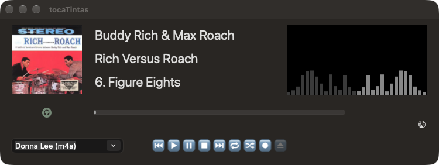
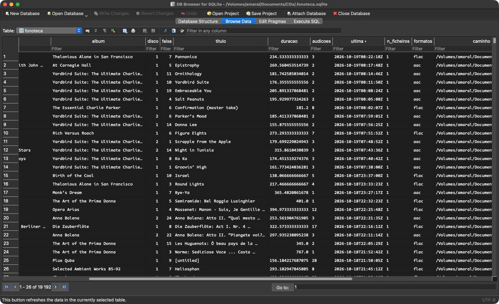
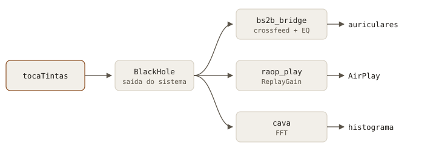
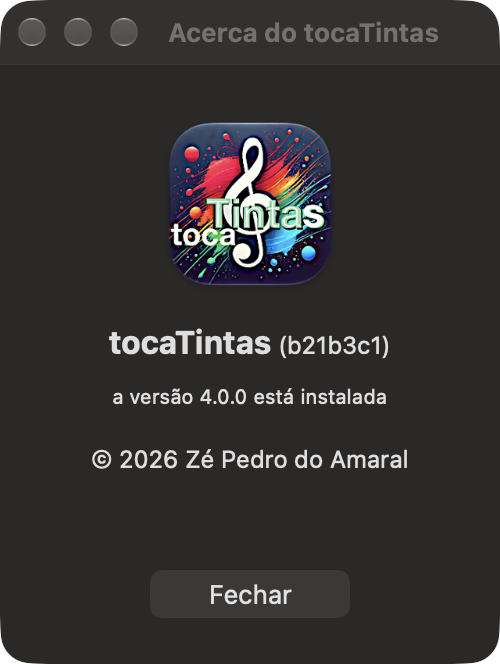

# tocaTintas

tocaTintas 5.0.0 (Manual do utente)

Novembro de 2026

## Índice

- [Nome](#nome)
- [Sinopse](#sinopse)
- [Descrição](#descricao)
- [Janela principal](#janela-principal)
- [Formatos](#formatos)
- [Capas](#capas)
- [Fonoteca](#fonoteca)
- [Base de dados da fonoteca](#base-da-fonoteca)
- [Audições do Música](#audicoes-do-musica)
- [Listas M3U e M3U8](#listas-m3u)
- [Estação](#estacao)
- [CD de áudio](#cd-de-audio)
- [O caminho do som](#caminho-do-som)
- [Auriculares](#auriculares)
- [AirPods](#airpods)
- [AirPlay](#airplay)
- [Sincronização](#sincronizacao)
- [Emparelhamento](#emparelhamento)
- [Gravação](#gravacao)
- [AppleScript](#applescript)
- [Histograma](#histograma)
- [Notificações](#notificacoes)
- [Página «a tocar»](#pagina-a-tocar)
- [Extensões do Finder](#extensoes)
- [Acerca e versão](#acerca)
- [Ficheiros](#ficheiros)
- [Requisitos](#requisitos)
- [Ver também](#ver-tambem)

<a id="nome"></a>

## Nome

tocaTintas: leitor de música para macOS, com crossfeed, AirPlay e gravação.

<a id="sinopse"></a>

## Sinopse

**tocaTintas**

**Ficheiro** ▸ **Abrir…** *lista.m3u* | *lista.m3u8*

**Ficheiro** ▸ **Tocar o CD**

**Ficheiro** ▸ **Ligar faixas do Música…**

**Ficheiro** ▸ **Sincronizar com o Música**

**Ficheiro** ▸ **Guardar estação…** (⌘S)

**Ficheiro** ▸ **Guardar estação como…** (⇧⌘S)

**Reprodução** ▸ *as teclas do tocador*

**Reprodução** ▸ **Criar estação**

**Reprodução** ▸ **Sair do modo corrente** (⇧⌘P)

**Ajuda** ▸ **Ajuda do tocaTintas** (⌘?)

`osascript -e 'tell application "tocaTintas" to` *comando*`'`

<a id="descricao"></a>

## Descrição

O **tocaTintas** toca a fonoteca guardada num volume e poderá gerir faixas em FLAC, WavPack, Monkey’s Audio, ALAC e outros formatos. Para o fazer, percorrerá uma pasta de música e todas as suas subpastas, e poderá tocar tudo o que lá encontre por ordem, ao acaso ou em repetição.

Cada faixa toca mostrando a sua **capa**. Esta poderá ser a que vem embutida no ficheiro ou, se essa não existir, a que estiver na pasta de imagem de capa do álbum. A capa aparecerá na janela do tocador, na notificação do sistema, na página WWW «a tocar» e no caso dos WavPack nos ícones gerados pelo Finder. Adicionalmente, um CD receberá também uma capa de álbum. Esta poderá ser a que já exista na fonoteca ou uma obtida no Cover Art Archive (ver [**CAPAS**](#capas)).

Além disso, faz uma série de ajustes de som:

- crossfeed [bs2b](https://bs2b.sourceforge.net/) e equalização [AutoEQ](https://github.com/jaakkopasanen/AutoEq) para os auriculares;
- áudio espacial nos AirPods, com o tocaTintas integrado no «A tocar» do sistema e comandado pelas hastes dos AirPods e pelas teclas multimédia do teclado;
- transmissão de áudio para receptores AirPlay e AirPlay 2, como o HomePod e a Apple TV;
- leitura de CDs, com metadados ad hoc vindos do [MusicBrainz](https://musicbrainz.org/) e do [gnudb](https://gnudb.org/);
- contagem das audições numa base de dados da fonoteca (SQLite), que combina também o que se ouve na aplicação Música para produzir uma contagem integral da música independentemente da sua origem;
- gravação do que o Mac tocar, bit a bit e à frequência do original, incluindo o Dolby Atmos binaural da aplicação Música;
- um histograma de frequências em tempo real e sincronizado mesmo quando a reprodução é remota via AirPlay;
- suporte de AppleScript, para ser comandado de fora e para integração com o Música.

<a id="janela-principal"></a>

## Janela principal



<sub>Fig. 1 — o tocador a tocar «Figure Eights» de *Rich Versus Roach*.</sub>

À esquerda fica a capa. Ao centro estão o artista, o álbum e a faixa, em etiquetas que deslizam quando o texto não cabe, e à direita o histograma. Por baixo de tudo fica a barra de progresso.

**etiquetas deslizantes**

Um texto que não caiba aparece truncado com «…» (*Bach: Goldberg…BWV 988*), como em qualquer etiqueta do macOS. Periodicamente, deslizará da direita para a esquerda para se poder ler todo. No fim, voltará à forma truncada. As bordas esbatem-se, para que o texto mude suavemente.

As três etiquetas revezam-se, e só uma deslizará de cada vez pela ordem: artista, álbum e faixa. As que cabem são saltadas. Quando começar uma faixa nova, o texto não deslizará durante 2 s. Uma passagem de texto só começará se a faixa durar tempo suficiente, para que um título não esteja a meio caminho quando a faixa seguinte começar.

**escolher a música**

O menu em baixo, à esquerda, lista as faixas da pasta corrente, cada uma com o formato entre parênteses: `(flac)`, `(wv)` e, nos `.m4a`, `(aac)` ou `(alac)`, conforme o que a fonoteca disser que lá está. Pode escrever-se o princípio do nome de uma faixa para a procurar. e programa autocompletará com o que encontrar que for coincidindo. O sistema funciona para caracteres acentuados e um título que comece por um número («12 Études») também se poderá procurar escrevendo esse número.

**⏮ ▶ ⏸ ⏹ ⏭**

Anterior, tocar, pausa, parar e seguinte. Quando o programa estiver a interagir com o Música e o tocador mostrar o que a aplicação Música estiver a tocar, os botões comandarão o Música (ver a seguir).

As mesmas teclas estão no menu **Reprodução**, com as de repetir, baralhar, gravar (o ⏺) e ejectar. Cada opção carrega no botão correspondente e faz exactamente o mesmo que ele. As que estiverem ligadas aparecem marcadas.

Os atalhos são os do Música: a barra de espaços toca ou pausa, ⌘. pára, ⌘← e ⌘→ vão à faixa anterior e à seguinte e ⌘E ejecta o CD. Só valem na janela do tocador. Enquanto o cursor estiver na caixa das músicas, a barra de espaços e as setas servem para escrever.

**repetir**, **baralhar**

O botão de repetir volta a tocar a faixa em curso quando ela chega ao fim, continuamente, até ser desligado. Cada repetição contará como uma audição nova. O botão de baralhar baralha a lista escolhida (ou a fonoteca inteira) uma vez, e essa ordem manter-se-á até ao botão ser desligado. Nenhuma faixa se repete antes de todas terem sido tocadas.

**⏺**

Grava para WAV (ver [**GRAVAÇÃO**](#gravacao)).

**⏏**

Ejecta o CD. Este botão só ficará activo quando houver um disco no leitor.

**auriculares** (à esquerda, por baixo da capa)

Liga e desliga o tratamento de som para os auriculares. O tratamento inclui crossfeed e equalização. Este tratamento funciona **sem mexer no volume**, para se poder comparar o som com e sem tratamento. Cor quer dizer ligado e branco desligado. Sem auriculares ligados, o botão apitará se premido mas nada mudará.

**AirPlay** (à direita, por baixo do histograma)

Escolhe o receptor. Com **⌘-clique**, a sessão com o receptor corrente será reaberta, o que resolverá os casos em que o receptor tenha adormecido ou quando a rede tiver sido interrompida durante algum tempo.

Se a transmissão tiver começado pela Wi‑Fi — ao acordar, a Wi‑Fi liga-se antes do cabo — e o cabo estiver entretanto disponível na mesma rede do receptor, o tocaTintas reabre sozinho a sessão para passar a transmissão para o cabo. Fá-lo no primeiro silêncio de dois segundos: uma pausa, o fim do álbum ou o intervalo entre faixas que o tenham. Num álbum de faixas encadeadas, espera pela pausa ou pelo fim. Sem cabo, como numa rede só de Wi‑Fi, nada disto acontece.

### O que a aplicação Música toca

Quando o programa Música estiver a tocar e o tocaTintas não estiver, o tocador mostrará a música que o programa Música estiver tocando: a capa, o artista, o álbum, o título e a barra de progresso. O título leva ♫, o número da faixa e o número total de faixas do álbum à frente do título da faixa, para que seja claro que vem do Música e não da fonoteca. Este modo serve sobretudo para gravar. Logo que o tocaTintas toque alguma coisa sua, a janela voltará a ser sua.

**os botões**

Com o Música no tocador, os botões ⏮ ▶ ⏸ ⏹ ⏭ comandam o Música. O ⏸ alterna entre pausa e reprodução, como no tocaTintas. O ⏮ vai sempre à faixa anterior, também como no tocaTintas, e não ao princípio da faixa, como o botão do próprio Música. O ⏹ pára o Música e devolve a janela ao tocaTintas. Para voltar ao tocaTintas mesmo com o Música a correr, escolhe-se uma faixa da fonoteca ou simplesmente pára-se primeiro o Música.

**a contagem**

No canto inferior direito do tocador é mostrado quantas vezes a faixa já tocou. Para as faixas da biblioteca do Música, a contagem é a do próprio Música. O Música não guarda qualquer contagem para as faixas do catálogo do Apple Music que não tiverem uma cópia local e para as das estações. Nestes casos, gera-se uma entrada normalizada de contagem na base de dados. Esta contagem na base de dados do tocaTintas combinará essas audições do Apple Music com as audições da mesma música nos ficheiros e nos CDs (ver [**AUDIÇÕES DO MÚSICA**](#audicoes-do-musica)).

**a capa**

Para as faixas da biblioteca do Música, a capa será a que o Música der. Para as faixas do catálogo e das estações do Apple Music, o tocaTintas irá buscar a capa directamente ao catálogo da Apple através da pesquisa pública do iTunes da loja do país onde o Mac estiver. Procurará primeiro o artista e, entre os álbuns dele, o que tenha o nome do que estiver a ser tocado. Se isto não funcionar, pesquisará o álbum pelo artista e pelo nome e, por fim, a faixa pelo artista e pelo título, e dela inferirá o nome do álbum. O nome do álbum compara-se sem contar maiúsculas e acentos e, se for preciso, sem sufixos de edição como «(Deluxe Version)», «- EP» ou «- Single». Entre os álbuns que coincidam, os do mesmo artista terão prioridade. Não havendo correspondência, ficará a imagem genérica, pois capa nenhuma será melhor do que capa errada. Por tudo isto, a capa poderá chegar uns instantes depois do resto.

<a id="formatos"></a>

## Formatos

[FLAC](https://xiph.org/flac/), [WavPack](https://www.wavpack.com/) (`.wv`), [Monkey’s Audio](https://www.monkeysaudio.com/) (`.ape`), [ALAC](https://github.com/macosforge/alac) e AAC (`.m4a`), AIFF, MP3 e [Opus](https://opus-codec.org/). Quando a mesma faixa existir em vários formatos, a preferência segue a ordem desta lista.

As etiquetas lêem-se do próprio ficheiro: comentários Vorbis no FLAC e no Opus, e APEv2 no WavPack e no Monkey’s Audio.

<a id="capas"></a>

## Capas

**Ficheiros**

Primeiro procura-se a capa embutida, que é o bloco PICTURE do FLAC ou o item `Cover Art (Front)` do APEv2. Se não houver, procura-se na pasta do álbum, por esta ordem:

1. `albumart_backup/cover.jpg` ou `.png`, onde o **abcde**(1) guarda a capa de cada álbum;
2. `cover.jpg`, `folder.jpg`, `front.jpg`, `cover.png` e `folder.png`;
3. qualquer imagem da pasta, por ordem alfabética.

O terceiro passo existe por causa do abcde. Ao embutir a capa nos vários formatos, ele poderá apagar a `cover.jpg` e a deixar só as `cover-resized-NNNN.jpg`.

**CDs**

As fontes consultam-se pela ordem escolhida no separador **CD** das Preferências do tocaTintas: a imagem da pasta do mesmo álbum na fonoteca ou a do [Cover Art Archive](https://coverartarchive.org/). Neste último, tenta-se primeiro a capa da edição que o MusicBrainz identificou, depois a de outra edição do mesmo disco e, por fim, a do grupo de lançamento, que pode ser a de outra edição do mesmo álbum, mesmo noutro formato. O gnudb não tem capas.

**Aplicação Música**

Ver [o que a aplicação Música toca](#janela-principal), na janela principal.

**Sem capa**

Um CD cuja capa não tenha sido encontrada ou uma faixa sem capa ficarão com a imagem genérica do tocaTintas.

<a id="fonoteca"></a>

## Fonoteca

A pasta de música escolhe-se nas Preferências, no separador **música**. O tocaTintas percorrerá então todas as subpastas e encontrará os ficheiros de áudio nelas contidos.

Dentro dessa pasta principal poderá estar `.fonoteca.sqlite`, a base de dados mantida pelo **verificar_md5IV.sh** e pelo **fonoteca.py**. Nessa base de dados, cada música tem um UUID, que é o mesmo na etiqueta `FONOTECA_ID` do ficheiro e na faixa do CD donde veio. O tocaTintas acrescenta-lhe o número de audições e os discos que tocou antes de terem sido riporinados. Quando preenche um campo, só o faz se ele estiver vazio, e nunca apaga nem substitui informação (ver [**A BASE DE DADOS DA FONOTECA**](#base-da-fonoteca)).

A base de dados pode estar num disco externo mesmo que esteja em pausa. Todo o fluxo de acesso à base de dados passa por uma fila própria, fora do thread principal, e se a base não estiver disponível, o tocaTintas continuará a tentar actualizar a base de dados até ao disco acordar ou ser outra vez montado.

### Registo automático

Um álbum novo, ou uma pasta que tenha mudado de nome ou de sítio, entrará na base de dados sem ser preciso correr manualmente quaisquer programas. O tocaTintas acompanha a pasta de música pelo FSEvents do macOS e, quando ela ficar um minuto sem mudanças, correrá automaticamente o `fonoteca.py registar` nas as pastas que mudaram. O minuto de espera existe porque um rip ou um corte escrevem durante muito tempo, e o registo pode gravar o `FONOTECA_ID` nos ficheiros, o que nunca deve acontecer num ficheiro incompleto.

O registo trata dos ficheiros novos, dos que mudaram de sítio (reconhecidos pelo MD5 do áudio e pelo `FONOTECA_ID`), dos que desapareceram e das audições que não tenham ficheiro. Não verifica a integridade da informação do áudio, que continua a ser trabalho do verificar_md5IV.sh via determinação e comparação de MD5. A saída fica em `registar.log`. Se houver ficheiros com problemas, ou se o registo não chegar a correr, aparecerá uma notificação.

As MD5 do áudio guardam-se num único `.md5sum.txt`, na pasta da base (`CDs/`). O verificar_md5IV.sh refá-lo a partir da base de cada vez que corre, e apagará os `.md5sum.txt` antigos que encontre nas subpastas.

### Verificação diária

Uma vez por dia, o tocaTintas corre o `fonoteca.py consistencia`, que só lê e não muda nada. Reconcilia a base de dados com a realidade: ficheiros de áudio na pasta de música que a base não tem, e faixas do Música que deviam estar ligadas à versão local do seu álbum e não estão. Se encontrar alguma coisa, aparecerá a notificação «Fonoteca: há contas por acertar», com o primeiro problema, e o resto fica em `sincronizar-musica.log`. Se estiver tudo certo, não diz nada. A verificação correrá mesmo com o Música fechado.

<a id="base-da-fonoteca"></a>

## A base de dados da fonoteca



*Fig. 3 — a vista `fonoteca` no DB Browser for SQLite, ordenada pela última audição.*

A base de dados indentifica três coisas: a **música** (uma gravação), o **ficheiro** (onde ela está agora, num dado formato) e o **disco** (o CD de onde veio). Uma dada música pode ter vários ficheiros, por exemplo um FLAC e um AAC da mesma gravação, e pode estar em vários discos, como uma compilação e o álbum original. As audições contam-se na música, e por isso não se perdem quando um ficheiro muda de nome, de pasta ou de formato. A aplicação Música entra como uma quarta fonte, com as suas próprias faixas.

### Tabelas

**musicas** (37 675)

Uma linha por gravação. A chave é um UUID v4, o mesmo que está na etiqueta `FONOTECA_ID` dos ficheiros. Guarda o título, o artista, o álbum, o disco, a faixa e a duração, e, como referência, os identificadores do MusicBrainz da gravação e do lançamento. Cerca de metade são músicas que só existem no programa Música.

**ficheiros** (19 471)

Uma linha por ficheiro de áudio, com a música a que pertence, o **MD5 do áudio**, o formato, o caminho e a última vez que o caminho foi confirmado. A MD5 é exclusivamenta a do som: das tramas ou dos pacotes de áudio tal como estão, sem considerar os metadados, para que mudá-los não a altere. Só o Monkey’s Audio é descodificado para PCM. Um ficheiro que desapareça, ficaria com o caminho a NULL em vez de ser apagado da base de dados. Assim, a sua história continuaria na base de dados, e a MD5 permitiria reconhecê-lo se voltasse a aparecer mais tarde.

**discos** (1 237)

Os CDs, pelo identificador CDDB de oito dígitos e, quando se conhecem, pela TOC completa e pelo disc ID do MusicBrainz. Usar só o CDDB não basta, porque discos diferentes podem partilhá-lo. Por isso, o que é único é o par CDDB e TOC.

**faixas_cd** (15 991)

A ligação entre discos e músicas: a faixa *n* do disco *d* é a música *m*. É por esta via que um CD metido no leitor encontra os nomes, a capa e o ganho na fonoteca, e que uma audição do CD e um ficheiro riporinado contam para a mesma música.

**faixas_musica** (37 896)

As faixas da aplicação Música, pelo persistent ID que o Música lhes dá, cada uma ligada à sua música. O estado diz como foi ligada: automaticamente, por escolha, com uma música própria criada para ela, ou ainda pendente de escolha. Guarda também o que o Música mostra (artista, álbum, faixa, título e duração), a contagem que o Música tinha quando a faixa entrou na base e a última contagem já registada. As faixas do catálogo tocadas fora da biblioteca têm uma chave tirada da própria faixa, porque o persistent ID delas muda a cada reprodução. Ver [**AUDIÇÕES DO MÚSICA**](#audicoes-do-musica).

**candidatas_musica** (5 098)

Para cada faixa pendente, as músicas a que pode corresponder, pela ordem de preferência, com o critério que as encontrou e a diferença de duração.

**audicoes** (992)

Uma linha por audição, com a música, a data e hora (ISO 8601, em UTC), a origem (`ficheiro`, `cd` ou `musica`) e o ficheiro, o disco ou a faixa do Música que tocou. Uma faixa do tocaTintas conta ao fim de 5 segundos de audição efectiva. Pausar e retomar não avançarão a contagem, nem avançar antes dos 5 segundos, e cada reprodução contará uma vez. As regras da aplicação Música estão em [**AUDIÇÕES DO MÚSICA**](#audicoes-do-musica).

**assinaturas** (19 682)

Uma linha por música e por modelo, com o vector de 512 números (em vírgula flutuante de 16 bits, 1024 octetos), o MD5 do áudio de que foi tirado e a data. O nome do modelo inclui a maneira de tirar os excertos (`larger_clap_music/3x10s`), para que as assinaturas de outro modelo ou de outro método nunca se misturem com estas. Ver [**ESTAÇÃO**](#estacao).

### Vistas

**contagens**

Por música, o total de audições e a data da última. O total soma as contagens importadas, as que o Música tinha quando as suas faixas foram ligadas à música e as audições registadas.

**ficheiros_contagens**

Por ficheiro, quantas vezes a música tocou ao todo e quantas tocou **este** ficheiro. É o que permite comparar o FLAC com o AAC da mesma música.

**fonoteca**

A vista de leitura, a da Fig. 3. Tem uma linha por música, com as audições, a última, quantos ficheiros tem, os formatos (`aac+flac`), o caminho preferido (o do FLAC, se houver) e os CDs onde está, no formato `cddb:faixa`.

**audicoes_locais**

As audições à hora local, a mais recente primeiro. Mostra a hora (WET ou WEST, conforme a data), o artista, o álbum, o título, quantas vezes a música já tocou ao todo (a contagem que a janela mostra) e o que tocou: `flac`, `aac`, `alac`, `mp3`, `cd` ou `música`. A tabela guarda as horas em UTC, para que a ordem e as contas não se baralhem na mudança de hora. A conversão faz-se na leitura e acompanha a hora de Verão de cada audição.

A janela **Reprodução ▸ Contagens…** mostra a última audição de cada música, com as colunas desta vista, e nas «vezes» o total da música. Não deixa nenhuma de fora: mostra-as em páginas de mil, e os botões do rodapé andam uma página (‹ ›) ou dez (« »). Abre na página do topo, a das mais recentes, onde « e ‹ estão desligados; na última página, são › e ». A janela relê-se sozinha enquanto estiver aberta, e uma música que volte a tocar sobe para o topo. Pode filtrar-se por artista, álbum, título, formato ou data, ordenar por qualquer coluna, e copiar as linhas seleccionadas com ⌘C. A base não fica presa: cada leitura abre-a só para leitura e fecha-a logo, ao contrário de um programa como o DB Browser for SQLite, que a mantém aberta e impede que o registo das audições passe do `-wal` para a base.

### Quem escreve o quê

O **verificar_md5IV.sh** e o **fonoteca.py** são os curadores das músicas, dos ficheiros, dos discos e das faixas dos CDs. O `fonoteca.py sincronizar-musica` regista as audições que o Música contou, integrando tudo na base de dados. Na base de dados, o tocaTintas acrescenta:

- uma linha em **audicoes** por cada faixa ouvida;
- uma linha em **musicas** só com o UUID, quando toca um ficheiro com `FONOTECA_ID` que o fonoteca.py ainda não viu, e que este completa da vez seguinte;
- o disco e as suas faixas, quando toca um CD que a base de dados ainda não conheça. Os nomes vêm do MusicBrainz ou do gnudb e ficam registados à espera que um dia o ficheiro seja riporinado;
- a TOC e o disc ID de um disco conhecido só pelo CDDB, e o título, o artista e o álbum de uma faixa que não os tenha;
- as escolhas feitas na janela **Ligar faixas do Música**, e as audições das faixas do catálogo da Apple, pelo `fonoteca.py ouvir-musica`.

O **vectorizar** escreve só na tabela **assinaturas**, que cria se não existir.

Os campos da quarta alínea só se escrevem quando estão vazios. O que os os roteiros da fonoteca lá puseram automaticamente nunca será substituído.

### Exemplos

```
sqlite3 -readonly CDs/.fonoteca.sqlite \
  "SELECT audicoes, artista, titulo FROM fonoteca
   ORDER BY audicoes DESC LIMIT 10"
```

As dez músicas mais ouvidas. Com a opção `-readonly`, a consulta de dados não interfere com o tocaTintas a correr.

```
sqlite3 -readonly -header -column CDs/.fonoteca.sqlite \
  "SELECT * FROM audicoes_locais LIMIT 20"
```

As últimas vinte audições, à hora local.

<a id="audicoes-do-musica"></a>

## Audições da aplicação Música

O que se ouvir na aplicação Música também contará na base de dados da fonoteca. Se a mesma gravação existir num ficheiro ou num CD, as audições somam-se às dessa música. Se não existir, a faixa do Música ficará com uma entrade de música própria.

### As três regras

| toca | conta | quem |
|---|---|---|
| Um ficheiro ou um CD, no tocaTintas | aos 5 s de audição | o tocaTintas |
| Uma faixa da biblioteca do Música | quando a faixa chega ao fim | o Música, com o seu «played count» |
| Uma faixa do catálogo fora da biblioteca, ou de uma estação | aos 5 s de audição | o tocaTintas |

A terceira regra existe porque o Música não guarda contagens para as faixas que não estejam na biblioteca. Nesse caso, quem conta é o tocaTintas, pela mesma regra com que conta as audições dos seus ficheiros. Se a faixa for depois acrescentada à biblioteca local do Música, o tocaTintas deixará de a contar e a contagem passará a ser a do Música (mas registada e contabilizada na base de dados).

O Música continuará a tocar quando o tocaTintas fechar ou reiniciar. Por isso, a audição em curso é verificada a cada segundo que passe. Ao voltar, se o Música ainda estiver na mesma faixa e não tiver voltado ao princípio, a audição continuará onde estava: o que já tinha tocado soma, e o que já tinha contado não conta outra vez.

### Sincronização

O `fonoteca.py sincronizar-musica` lê a biblioteca do Música de uma vez, em poucos segundos, mas só se o Música estiver a correr. O tocaTintas executa-o a primeira vez um minuto depois de arrancar e subsequentemente de meia em meia hora. Também se pode correr à mão em **Ficheiro** ▸ **Sincronizar com o Música**.

A cada sincronização:

- cada faixa nova é ligada à sua música, fica pendente de escolha ou recebe uma música própria. A contagem que o Música já tinha passa a contar logo que a faixa está ligada;
- cada aumento da contagem do Música numa faixa ligada passa a ser uma audição, com a data da última reprodução que o Música guardou;
- as faixas pendentes são reavaliadas, porque entretanto pode ter aparecido a versão certa;
- uma música própria funde-se com a versão local logo que esta apareça sem dúvida, por exemplo depois de se gravar o álbum a partir do Música;
- as ligações automáticas são revistas: uma faixa ligada a uma música sem ficheiro, ou a uma música de outro álbum, passa para a versão local do mesmo álbum quando ela existe, com o mesmo número de faixa, um título parecido e uma duração que não difere mais de 2 s. As escolhas feitas à mão na janela **Ligar faixas do Música** nunca são mudadas.

Nenhuma contagem vem de fora da base. O antigo `contagens.json` já não é lido: o que lá estava entrou uma vez, pela importação, e daí em diante só contam as audições registadas.

Se o Música passar a mostrar uma contagem mais baixa, por exemplo porque a faixa foi apagada e reposta, o que já estava registado fica.

### Como se liga uma faixa

Uma faixa do Música liga-se sozinha a uma música da base quando há uma única candidata, com uma duração que não difere mais de 2 s, segundo um destes critérios, do mais estreito para o mais largo:

1. o artista, o álbum, o disco, a faixa e o título iguais;
2. o artista principal e o título iguais;
3. o artista principal e o título iguais, sem contar sufixos de remasterização como «(2015 Remaster)».

Há ainda um caso que se liga sozinho: o mesmo artista, o mesmo álbum e o mesmo título, com uma diferença de duração até 5 s. É o mesmo disco noutra masterização, ou com pausas diferentes no início e no fim. O «Sea, Swallow Me» do CD dura 191,4 s e o do Música 189,0 s. No título só se ignora a remasterização: «(Mono Mix)», «(EP Version)» ou «(Alternate Mix)» são outras misturas e não se ligam assim.

Uma candidata que só exista na aplicação Música nunca passa à frente de uma versão local possível. Nesse caso, a faixa fica para escolha.

Ficam pendentes as faixas com candidatas mas sem nenhuma certa. São encontradas pelo título sem sufixos de versão («Live», «Mix», «Edit»…), pelo álbum e número da faixa, muito usado na música clássica, em que o Música e o MusicBrainz escrevem o artista de maneiras diferentes, ou pelo título com outra duração. Uma faixa pendente ainda não conta. O que o Música tiver contado entretanto entra quando ela for ligada.

### A janela «Ligar faixas do Música»

Abre-se em **Ficheiro** ▸ **Ligar faixas do Música…**, ou clicando na notificação «Faixas do Música por ligar», que aparece quando o número de pendentes aumenta. É o mesmo género de escolha que o Música propõe quando um CD tem várias entradas.

Ao abrir, a janela sincroniza com o Música, para que as candidatas contem com o que se registou entretanto — um álbum gravado, aprovado e aberto agora mesmo, por exemplo. Se houver ficheiros a registar, espera primeiro por eles. Enquanto isso, no lugar da contagem lê-se «A actualizar com o Música…», e só se pode ouvir: as escolhas esperam pelas candidatas novas. Com o Música fechado não há sincronização, e a janela mostra o que a base já tem.

Em cima estão as faixas pendentes, com um campo para filtrar por artista, álbum ou título. Por baixo estão as candidatas da faixa escolhida, as músicas da fonoteca que se lhe parecem, com a sugestão já seleccionada, a diferença de duração, onde está cada uma (o formato, o CD ou «só no Música») e o parecer. A última opção é sempre **Nenhuma — entrada nova**.

O **parecer** vem da diferença de duração e do que os títulos dizem da versão (o que está entre parênteses ou depois de « - », sem contar a remasterização nem os convidados):

- **mesma gravação**: até 3 s de diferença e nenhuma indicação de versão diferente. Uma remasterização diferente não muda o parecer;
- **outra versão**: mais de 10 s de diferença;
- **por ouvir**: tudo o resto, como a mesma duração com «(7″ Version)» de um lado e nada do outro.

Entre parênteses fica o critério com que a candidata foi encontrada.

Por baixo das duas tabelas, uma grelha põe lado a lado, campo a campo (artista, álbum, número, título, duração, onde está e quantas vezes tocou), a faixa **Tocado no Música** e aquilo com que está **Identificado com**, a candidata escolhida na tabela das candidatas. O que difere entre as duas fica a laranja na candidata. Segue-se o parecer por extenso e a razão dele, quantas faixas do Música já estão ligadas à candidata, e a consequência da escolha. Ao ligar, as audições da faixa passam a contar para a candidata, e diz-se com quantas fica. Se a candidata tem ficheiro local, é ele que toca nas estações, e a faixa do Música não entra nelas; se não tem, continua a tocar pelo Música. Como entrada nova, a faixa fica como música própria, com contagem só dela, e entra nas estações como faixa do Música. Quando a sugestão é uma entrada nova, a comparação diz quanto difere a candidata mais próxima; para a ligar, basta escolhê-la na tabela das candidatas.

**Ligar à candidata** ou **Entrada nova** (↩, ou duplo clique)

O botão muda com a linha escolhida na tabela das candidatas: com uma candidata, liga a faixa a ela; com «Nenhuma», faz dela uma entrada nova, música própria. Em ambos os casos grava a escolha e passa à faixa seguinte.

**Adiar**

Não grava nada: deixa a faixa pendente e passa à seguinte.

**Ligar o álbum todo…**

Aceita as sugestões de todas as faixas pendentes do mesmo álbum, depois de uma confirmação que diz quantas ficam ligadas e quantas ficam como entradas novas. É a forma rápida de tratar os discos de música clássica.

**▶︎ Ouvir a do Música** e **▶︎ Ouvir a candidata**

Tocam dez segundos de cada lado, para comparar de ouvido. Não contam como audição nem mexem no Música. A candidata com ficheiro ouve-se dele, a partir de 30% da duração (só nos formatos que o macOS lê sozinho: FLAC, ALAC, AAC e MP3). A faixa do Música, e a candidata que só lá existe, ouvem-se pelo excerto de 30 segundos da loja da Apple: o da própria versão, escolhido pela duração, ou nenhum, e nesse caso a comparação diz que não há amostra. Para a loja vão só o artista e o título.

A sugestão é a primeira candidata com parecer de mesma gravação. Não havendo nenhuma, é a primeira de todas, excepto quando só foi encontrada pelo título com outra duração: nesse caso, a sugestão é **Nenhuma** (entrada nova).

<a id="listas-m3u"></a>

## Listas M3U e M3U8

**Ficheiro** ▸ **Abrir…** (⌘O)

Aceita listas `.m3u` e `.m3u8`, que para o macOS são o mesmo tipo de ficheiro (`public.m3u-playlist`). As listas abertas ficam em **Ficheiro** ▸ **Abrir recentes**.

**Reprodução** ▸ **Sair do modo corrente** (⇧⌘P)

Volta à fonoteca e mantém a faixa que está a tocar.

### O que se lê da lista

- Uma faixa por linha. O caminho pode ser **absoluto**, começar por `~`, ser um endereço `file://` ou ser **relativo**. Neste caso, conta a partir da pasta onde está a lista, como nos outros leitores.
- As linhas que começam por `#` são ignoradas, incluindo `#EXTM3U` e `#EXTINF`. O título e a duração vêm sempre das etiquetas do próprio ficheiro, nunca da lista.
- O ficheiro lê-se em **UTF-8**, que é o que o `.m3u8` garante, com ou sem a marca de ordem dos octetos no início. Se não for UTF-8, lê-se em **Windows-1252** e, por fim, em **Latin-1**, as codificações dos `.m3u` antigos. Um ficheiro em Windows-1252 com acentos quase nunca é UTF-8 válido, e por isso as tentativas sucessivas não se confundem.

### Ao abrir

A lista passa a ser o que toca, e a fonoteca fica onde estava. Abrir uma lista **não interrompe** o que se está a ouvir. Se a faixa em curso fizer parte da lista, continua a tocar, já dentro dela. Se não fizer, acaba de tocar e a seguinte é a primeira da lista. Com o leitor parado, nada arranca sozinho, e o ▶ começa pela primeira faixa. Com o baralhamento ligado, a lista é baralhada.

### Limitações

- Os endereços de rede (`http://…`) não são suportados.
- O tocaTintas lê listas, mas só guarda as das estações (ver [**ESTAÇÃO**](#estacao)).

<a id="estacao"></a>

## Estação

**Reprodução** ▸ **Criar estação**

Faz uma lista de 50 faixas a partir da que está a tocar ou em pausa: ela própria, à cabeça, e as da fonoteca que mais se lhe assemelham no som, por ordem de semelhança. A estação comporta-se como uma lista M3U acabada de abrir: a faixa em curso continua a tocar, já dentro dela, e **Reprodução** ▸ **Sair do modo corrente** volta à fonoteca. Com o baralhamento ligado, a estação é baralhada. Com o tocador parado e sem o Música na janela, a opção fica a cinzento.

A semelhança mede-se pelas **assinaturas**: um vector de 512 números por música, tirado de três excertos de 10 segundos (aos 25, 50 e 75% da faixa) por uma rede neuronal, o codificador de áudio do CLAP, na variante treinada para música (`music_audioset_epoch_15_esc_90.14`, do LAION), que corre no Neural Engine. Duas músicas são tanto mais parecidas quanto maior for o co-seno entre as suas assinaturas. O modelo ouve o som e não lê as etiquetas: reconhece bem o estilo e a instrumentação, e não sabe nada da língua nem da nacionalidade.

Enquanto a estação for a lista corrente, o título da faixa leva à frente o sinal de estação do Música (um ponto com ondas à direita), como o «♫» das faixas do Música. As faixas que a estação entrega ao Música levam as duas marcas; o que o Música toque por conta própria não leva a da estação. A marca é só da janela: o aviso, o «A tocar» e o AppleScript dão o título sem ela.

Na escolha das vizinhas há três regras: nunca outra versão da mesma canção (um título igual, sem contar com maiúsculas, acentos e o que vem entre parênteses), no máximo três faixas por artista e duas por álbum. Nas eruditas, o artista é o compositor. Numa colectânea de vários artistas, conta o álbum.

O artista da semente tem quota própria: cerca de uma faixa em cada cinco é dele (as mais parecidas com a semente, até três por álbum), espalhadas pela estação. E as listas M3U8 contam: se a semente estiver numa lista de `CDs/Listas`, as outras faixas dessa lista sobem um pouco na ordem, tanto mais quanto mais estreita for a lista (uma Shoegazing (curta) puxa mais do que a Portuguesa). Não contam as listas «Claude …», as estações gravadas e as de menos de cinco artistas; as listas lêem-se a cada estação, por isso uma lista mudada conta logo.

Quanto pesa cada uma destas coisas escolhe-se nas Preferências, no separador **estação**: a parte do artista da semente (20% por omissão; 0 volta à regra dos três por artista), o peso das listas, o dos vizinhos de ouvintes da ListenBrainz e o número de regressos à semente (as ondas). Valem para a próxima estação e para o prolongamento da que está a tocar; **Repor** volta aos valores de origem.

Não há sorteio: a mesma semente dá a mesma estação enquanto a fonoteca for a mesma. Um álbum novo, depois de registado e de ter as suas assinaturas, já pode entrar na estação seguinte.

### A semente

- **Um ficheiro da fonoteca**: usa-se a assinatura que a base já tem.
- **Uma faixa de um CD**: se o disco estiver na fonoteca, usa-se a assinatura do ficheiro correspondente, e a estação começa na faixa seguinte, para a semente não se ouvir duas vezes. Se não estiver, a assinatura é tirada do próprio disco, na hora.
- **Um ficheiro que a base não conhece**: a assinatura é tirada na hora, o que demora alguns segundos, e não fica guardada.
- **A faixa que o Música está a tocar**, com o Música na janela. Se a fonoteca a tiver ligada a uma música com ficheiro (ver [**AUDIÇÕES DO MÚSICA**](#audicoes-do-musica)), a semente é essa música, e a estação começa pela versão local. Senão, como nas faixas do catálogo da Apple, a assinatura tira-se do excerto de 30 segundos que a loja dá de cada faixa, e a semente fica à cabeça da lista como faixa do Música, se estiver na biblioteca dele: a faixa anterior (⏮) volta a ela. Uma faixa do catálogo que não esteja na biblioteca não entra na lista, porque não há maneira de a mandar tocar outra vez. O Música continua a tocar: a estação fica pronta no tocaTintas, à espera do ▶.

O excerto da loja é uma amostra pequena e nem sempre representativa. O de uma ária que comece por uma introdução longa da orquestra dá uma estação de música orquestral, e não de ópera.

**Ficheiro** ▸ **Guardar estação…** (⌘S)

Guarda a estação corrente como lista `.m3u8`, com os caminhos absolutos das faixas. Da primeira vez pergunta o nome e o sítio: o painel abre na pasta `Listas` da pasta de música, se ela existir, e propõe «Estação — *artista* — *título*». Depois disso a opção perde as reticências e volta a escrever no mesmo ficheiro, sem perguntar. A lista guardada fica em **Ficheiro** ▸ **Abrir recentes**.

**Ficheiro** ▸ **Guardar estação como…** (⇧⌘S)

Esta opção só aparece no menu enquanto a tecla ⇧ estiver carregada: toma o lugar de **Guardar estação…**.

Pergunta sempre o nome e o sítio, para guardar a mesma estação com outro nome ou noutra pasta.

As duas opções só estão activas enquanto a estação for a lista em vigor.

### Faixas do Música na estação

Havendo o **mapa do catálogo** (`.mapa-do-catalogo.sqlite`, na pasta das músicas, ao lado da fonoteca), a estação também vai buscar vizinhas às faixas da biblioteca do Música que não existem em ficheiro. A assinatura dessas vem do excerto de 30 segundos da loja da Apple, e é menos fina do que a de uma faixa inteira: serve para dizer se soa parecido, não para ordenar ao pormenor.

Há faixas que continuam na biblioteca do Música mas que ele já não consegue tocar. As que ele próprio dá como já não disponíveis (saíram do catálogo) ficam fora das estações; o mapa acerta esse estado a cada sincronização, e uma faixa que volte a estar disponível volta a entrar. As outras só se descobrem ao tocar: se o Música não arrancar a faixa em dez segundos, ou disser que a toca e parar logo no princípio, a lista salta para a seguinte e a falha fica anotada no mapa, uma por dia no máximo. À segunda falha, em dias diferentes, a faixa deixa de entrar nas estações.

O mapa mantém-se sozinho. Depois de cada sincronização com o Música (ao arrancar e de meia em meia hora), as faixas novas da biblioteca dele que já estejam ligadas a uma música e não tenham ficheiro local são procuradas na loja, assinadas e guardadas; o que se fez fica no `mapear.log`, na pasta de apoio da aplicação. Um álbum acabado de juntar ao Música entra nas estações, no pior dos casos, meia hora depois, mais uns segundos por álbum. As faixas pendentes só entram depois de ligadas, e as que a loja não tem não se voltam a pedir. Não corre durante uma gravação nem no modo de pouca energia.

Na caixa das músicas aparecem com «♫» e «(Música)». Quando chega a vez de uma, o tocaTintas manda o Música tocá-la uma vez e mostra-o na janela; no fim, a lista segue. Com o Música à vista por conta da lista, o ⏹, o ⏭ e o ⏮ são da lista, e o ▶ e o ⏸ são do Música. Se o Música não estiver a correr, ou a faixa já não estiver na biblioteca dele, a linha é saltada sem aviso; o tocaTintas nunca abre o Música por sua conta.

Numa lista guardada, estas faixas vão como `musica:` seguido do identificador que o Música lhes dá, com o nome numa linha `#EXTINF` antes. O identificador só vale nesta biblioteca: noutro computador, ou noutro tocador, essas linhas são saltadas. As faixas que só existem no catálogo da Apple não entram, porque o Música não as toca a partir de um endereço.

### Origem

O som sozinho não distingue um fado de uma canção francesa da mesma época. Por isso a estação pode ficar presa à origem da semente, dada pela etiqueta GENRE dos ficheiros: «Fado», «Fado de Coimbra», «Balada de Coimbra», «Portuguesa», «Brasileira», «Cabo-verdiana». O que cada origem admite edita-se em **Reprodução ▸ Estações…**, ou à mão em `origens.json`, na pasta de dados da aplicação. São duas listas:

- `origens`: para cada etiqueta, as etiquetas que uma semente com ela admite. Por exemplo, «Fado» admite «Fado» e «Fado de Coimbra»;
- `artistas`: excepções, que mandam sobre a origem. Sérgio Godinho admite também brasileiros e cabo-verdianos; Carminho, fado e brasileiros.

Na janela, à esquerda estão as sementes com regra (origens ou artistas, conforme o botão de cima), e à direita todas as etiquetas GENRE da fonoteca, com o número de faixas de cada uma; as que já são origens aparecem a negrito. Carregar no cabeçalho **Etiqueta GENRE** ordena-as por nome; em **Faixas**, da mais frequente para a menos. Um segundo clique inverte a ordem, e a escolha fica lembrada. Marcar ou desmarcar uma etiqueta diz se a semente escolhida a admite, e grava-se logo. O botão + acrescenta uma origem (das etiquetas que ainda não têm regra) ou um artista (dos da fonoteca, que começa com o que a origem dele admite); o − tira a regra escolhida. A regra de um artista vale também para os duetos dele («Sérgio Godinho com Caetano Veloso»).

Uma semente cuja etiqueta (ou artista) não tenha regra dá uma estação sem limite, como a de qualquer disco de rock. Numa estação limitada, uma faixa do Música entra com a origem que o mesmo artista tem nos ficheiros. Se o artista não tiver ficheiros, a origem vem do género que o Música lhe dá, traduzido no separador **Géneros do Música** («MPB» dá «Brasileira», «Fado» dá «Fado»), ou é escolhida à mão no separador **Artistas do Música**, que manda sobre tudo; «Nenhuma» deixa o artista fora de qualquer estação restrita. As tabelas destes dois separadores também se ordenam carregando no cabeçalho, por nome, género, faixas ou origem, e cada uma lembra a sua ordem. O género de cada faixa do Música guarda-se no mapa do catálogo a cada sincronização. Os portugueses de jazz e de electrónica guardam a etiqueta do estilo, e por isso não ficam presos à origem. Uma origem com poucas faixas dá uma estação mais curta: uma de música brasileira tem hoje uma dúzia.

As etiquetas lêem-se dos ficheiros e guardam-se na base (tabela `generos`) com a data de cada ficheiro: mudar uma etiqueta vale na estação seguinte. Um ficheiro com várias etiquetas GENRE («Shoegaze», «Rock») tem como origem a primeira que tenha regra; a janela mostra só a primeira de cada ficheiro.

### A seguir

**Reprodução ▸ A seguir…** abre uma janela com o que a estação tem alinhado para tocar depois da faixa que se ouve, por ordem: artista, título e álbum. Cada faixa tem uma caixa de marca, marcada à partida; desmarcada, a faixa não toca, mas fica à vista, apagada, e pode voltar a marcar-se. Arrastando uma linha muda-se a ordem por que as faixas tocam. Nada disto interrompe a faixa em curso. A lista anda sozinha a cada faixa. Com o aleatório ligado a ordem é a do baralho, e a janela não mostra a fila. «Guardar estação» guarda a fila como estiver, sem as desmarcadas.

Numa estação, a caixa das músicas mostra o mesmo que esta janela: a faixa que se ouve e as que estão alinhadas para tocar, pela ordem da fila. Só muda quando a estação avança (a faixa que tocou sai), quando se desmarca ou arrasta uma faixa na janela, e quando a estação se prolonga (as novas entram no fim). Escolher uma faixa na caixa salta para ela, e as que ficavam pelo meio saem da caixa; o botão da faixa anterior continua a voltar às que já tocaram. Com o aleatório ligado, a caixa mostra a estação inteira, como numa lista qualquer.

O que se faz na janela dá rumo à estação. Uma faixa desmarcada quer dizer «isto não é desta estação»; uma arrastada para cima, «quero mais disto». A estação não acaba nas primeiras 50 faixas: quando faltam cinco por tocar, o tocaTintas pede mais 25 ao `vectorizar`, com a mesma semente e o alvo puxado para as faixas promovidas (`--rumo`) e afastado das desmarcadas (`--longe`, com metade do peso). As novas entram no fim da fila; o que já estava arrumado não muda de sítio. Voltar a marcar uma faixa, ou arrastá-la para baixo, desfaz o gesto.

Os gestos ficam lembrados com a semente, em `estacoes.json`, na pasta de dados da aplicação: uma estação nova criada a partir da mesma faixa já não traz as desmarcadas e dá a frente às promovidas. Apagar esse ficheiro esquece tudo. Uma estação nascida de uma faixa do catálogo da Apple que não esteja no mapa (a semente é um excerto) não se prolonga nem fica lembrada.

### A consulta externa

A cada faixa que toca, de ficheiro ou do Música, o `vectorizar associar` corre em fundo e procura música que ainda não tem. Pergunta à **ListenBrainz** (dados abertos, sem conta) que artistas ouve quem ouve o artista da faixa; o identificador do artista vem do **MusicBrainz**. De cada vizinho vai buscar à loja da Apple as três canções que ela põe à frente e que não existem na fonoteca, tira a assinatura do excerto de 30 segundos e mede em que lugar essa canção ficaria entre as vizinhas da faixa que estava a tocar.

Com o «User token» da ListenBrainz guardado no Porta-chaves, as canções de cada vizinho passam a ser as mais ouvidas na ListenBrainz, e a loja só serve para as encontrar; cada passagem demora então mais. Guarda-se uma vez, no Terminal, com `security add-generic-password -s tocaTintas-ListenBrainz -a token -w`, e apaga-se com `security delete-generic-password -s tocaTintas-ListenBrainz`. O token só é enviado à ListenBrainz e não fica escrito em registo nenhum.

Tudo o que se apura fica no mapa do catálogo, aprovado ou não: quem é a canção, o endereço dela na loja, a assinatura, que faixa a trouxe e por que vizinho, e o lugar. Uma canção fraca para uma semente pode servir a outra. Estas canções não entram nas estações enquanto não estiverem na biblioteca do Música, porque não há maneira de as mandar tocar.

No Terminal, `vectorizar descobertas` *mapa* [*base* [`--semente` *faixa*]] lista-as, da mais parecida com a semente à menos, com o endereço na loja; `vectorizar esquecer` *mapa* *id* tira uma da lista. Para entrarem nas estações têm de ser juntas à biblioteca do Música.

Para fora vão só nomes de artistas. Corre uma passagem de cada vez, cerca de minuto e meio, e nunca durante uma gravação; o que faz fica escrito em `associar.log`, na pasta de dados da aplicação.

### Esboço e assinatura fina

A assinatura de uma música faz-se em dois tempos. O **esboço**, com três janelas de 10 segundos, fica pronto logo a seguir ao registo e serve de imediato. A **assinatura fina**, com quinze janelas espalhadas pela faixa, vem depois: de meia em meia hora, o tocaTintas põe o `vectorizar refinar` a correr durante 25 minutos, com a prioridade mínima de processador e de disco, a começar pelas músicas mais ouvidas. Não corre durante uma gravação nem em modo de pouca energia. A estação usa, de cada música, a fina se já a houver e o esboço se não.

Medido em 346 faixas: com três janelas, só 6 das 10 vizinhas mais próximas são as que a faixa lida por inteiro daria; com quinze são 9. Enquanto a biblioteca se vai refinando, a mesma semente pode dar estações um pouco diferentes de um dia para o outro.

### O vectorizar

As assinaturas e as estações são trabalho do **vectorizar**, um executável que vai dentro da aplicação, com o modelo ao lado (ver [**FICHEIROS**](#ficheiros)). Usa só o que o macOS traz: o ExtAudioFile para ler o som, o Accelerate para o espectrograma e o Core ML para o modelo. Pode ser corrido à mão:

- `vectorizar actualizar` *base*: calcula as assinaturas que faltam, das músicas novas e daquelas cujo ficheiro mudou de áudio. O tocaTintas corre-o depois de cada registo automático na fonoteca, e a saída fica em `registar.log`.
- `vectorizar estacao` *base* *caminho* | *uuid* [`-n` 50] [`--por-artista` 3] [`--por-album` 2] [`--ondas` 5] [`--ancora` 0.08]: escreve os caminhos da estação, um por linha. A escolha é pelo som, com uma âncora: as faixas dos artistas que a ListenBrainz dá como vizinhos do artista da semente (os que a consulta externa já guardou no mapa) sobem na ordem, até 0,08 na semelhança para o mais vizinho. A assinatura só conhece o som; a vizinhança de ouvintes traz a época e o país. Com `--ancora` 0 conta só o som. As faixas não saem por ordem de semelhança, que afastaria a estação da semente sem regresso, mas em ondas: cada onda começa perto da semente e afasta-se, e a seguinte volta ao pé dela. Com `--ondas` 1 saem da mais parecida à menos. `--da-semente` 0.2 é a parte da estação que cabe ao artista da semente (0: conta como os outros). `--ancora-das-listas` 0.03 é o bónus de quem partilha com a semente a lista mais estreita, e `--listas` *pasta* diz onde estão as M3U8 (por omissão, `Listas` ao lado da base). A aplicação passa-lhe os quatro valores do separador **estação** das Preferências.

A assinatura de uma música tira-se do seu FLAC, se o houver, e senão do primeiro dos outros ficheiros.

<a id="cd-de-audio"></a>

## CD de áudio

Quando se mete um CD, o tocaTintas pergunta se o deve tocar. Se sim, as faixas do disco passam a ser a lista em vigor, como uma lista M3U, e **Sair do modo corrente** volta à fonoteca.

Os nomes e a capa procuram-se pela ordem escolhida no separador **CD** das Preferências:

- **na fonoteca**, pelo identificador CDDB ou pelo disc ID do MusicBrainz guardado nos FLAC desse disco;
- **na internet**, primeiro no MusicBrainz (TOC completa, [disc ID](https://musicbrainz.org/doc/Disc_ID_Calculation) e gravações) e, para os discos que ele não conheça, no gnudb, o antigo freedb. O gnudb exige um endereço de email, e sem ele não é usado. Também não tem capas.

As respostas da internet ficam guardadas, e cada disco só se pede uma vez. O ganho ReplayGain vem sempre da fonoteca, quando o álbum lá está.

### O arranque do leitor

O **cddafs** do macOS não guarda cache, e duas leituras simultâneas atrasam-se uma à outra. Ao arrancar, o leitor físico fica parado entre 4 e 6 segundos. Durante esse tempo a janela diz «A preparar o leitor de CD…». Não é uma falha.

<a id="caminho-do-som"></a>

## O caminho do som

A saída do sistema é o [**BlackHole**](https://existential.audio/blackhole/), um aparelho de áudio virtual. Tudo o que o Mac toca entra nele, e dele parte para três sítios:



*Fig. 2 — a topologia de áudio. Os três programas auxiliares vêm dentro do `tocaTintas.app`.*

Por isso, o tratamento dos auriculares não afecta o que vai para o AirPlay, e a normalização do AirPlay não afecta o que vai para os auriculares. Nas colunas do Mac, o som passa sempre sem tratamento.

A excepção são os auriculares Bluetooth, como os AirPods: com eles como saída do sistema, o som vai directo para lá e o BlackHole só recebe uma cópia, para o histograma (ver [**AIRPODS**](#airpods)).

**frequência de amostragem**

O BlackHole trabalha a uma única frequência, a que estiver definida na **Configuração de Áudio MIDI**, e tudo o que o Mac toca é convertido para ela antes de lá entrar. A **44,1 kHz**, a frequência dos CDs, a fonoteca passa sem conversão nenhuma, e é essa a frequência para o uso de todos os dias. As outras servem para gravar (ver [**GRAVAÇÃO**](#gravacao)).

Os três auxiliares seguem a frequência do BlackHole. O **bs2b_bridge** lê-a ao arrancar e escreve-a na configuração do CamillaDSP, que de outro modo forçaria o BlackHole para a sua própria frequência e desfaria qualquer mudança. O **cava** abre o BlackHole à frequência dele. O caminho do AirPlay converte-a para a do receptor (ver [**AIRPLAY**](#airplay)). Mudar a frequência com o tocaTintas aberto obriga a ponte a reiniciar, e o som dos auriculares cala-se por um instante.

<a id="auriculares"></a>

## Auriculares

### Crossfeed

O [crossfeed](https://en.wikipedia.org/wiki/Crossfeed) mistura em cada ouvido um pouco do canal oposto, filtrado, como a cabeça faria ao ouvir colunas. Isso desfaz a sensação de o som estar dentro da cabeça. Há três intensidades, no separador **DSP**:

**Suave**

700 Hz / 4,5 dB. É o perfil por omissão do bs2b.

**Médio**

700 Hz / 6,0 dB, o perfil de Chu Moy.

**Forte**

650 Hz / 9,5 dB, o perfil de Jan Meier.

A mudança tem efeito imediato. O som cala-se por um instante enquanto o filtro reinicia.

### Equalização

O crossfeed imita a cabeça, e a equalização corrige os auriculares. No separador **auriculares** escolhem-se a marca e o modelo entre 523 correcções do [projecto AutoEQ](https://github.com/jaakkopasanen/AutoEq), de 106 marcas, para o alvo Harman over-ear. Todas foram medidas por [oratory1990](https://github.com/jaakkopasanen/AutoEq/tree/master/results/oratory1990), excepto a do Sony MDR-V600, que vem da Innerfidelity. A do Sony MDR-7506 vem embutida.

Para acrescentar outra, põe-se o ficheiro `ParametricEQ.txt` em `~/Library/Application Support/tocaTintas/eq`, na raiz ou numa subpasta com o nome da marca. A linha **Preamp** é lida e respeitada, e é ela que impede o reforço de graves de saturar a saída.

<a id="airpods"></a>

## AirPods

Com uns AirPods, ou outros auriculares Bluetooth, como saída do sistema, o tocaTintas toca directamente para eles. O tratamento é o dos próprios AirPods: a equalização, o cancelamento de ruído e o áudio espacial. O crossfeed e a equalização AutoEQ não se aplicam, e o botão dos auriculares não tem efeito.

### O «A tocar» do sistema

O tocaTintas aparece no «A tocar» do Centro de Controlo e do menu, com o título, o artista, o álbum, a capa e o tempo decorrido. Isto vale para qualquer saída, e não só para os AirPods. Daí, e das teclas multimédia do teclado, chegam tocar, pausa, parar, seguinte e anterior. Os saltos dentro da faixa não estão disponíveis.

Nos AirPods, as hastes comandam o tocaTintas:

- **um aperto**, em qualquer das hastes, pausa e retoma;
- **dois apertos** passam à faixa seguinte;
- **três apertos** voltam à anterior;
- **tirar um auricular do ouvido** pausa.

Com o Música na janela, estes comandos vão para o Música, como os botões (ver [**JANELA PRINCIPAL**](#janela-principal)).

### Áudio espacial

O «Espacializar estéreo» dos AirPods, com e sem seguimento da cabeça, só fica disponível se o leitor o pedir expressamente. O leitor habitual do tocaTintas não o pode pedir. Por isso, com a saída em Bluetooth, as faixas tocam por outro motor, que entrega o som ao sistema em blocos e pede a espacialização do estéreo. Encontra-se no menu do som ou no Centro de Controlo, carregando em **›** ao lado dos AirPods.

O motor escolhe-se no início de cada faixa. Se a saída mudar a meio, dos AirPods para a cavilha ou o contrário, o tocaTintas troca de motor e continua no mesmo ponto, sem parar a faixa.

O motor novo toca FLAC, ALAC, AAC, MP3, WAV e AIFF. O WavPack, o Monkey’s Audio e o Opus continuam pelo caminho de sempre, sem áudio espacial. O ReplayGain não se aplica, tal como nos outros auriculares, porque só o AirPlay o usa.

### O histograma

O som não passa pelo BlackHole, e o cava ficaria sem nada para ler. Por isso, o motor envia ao mesmo tempo uma cópia de cada bloco para o BlackHole, com o mesmo relógio. As barras acompanham o que se ouve nos AirPods, sem atraso a acertar. Se o BlackHole estiver silenciado, a cópia chega a zeros e o histograma fica parado. Isso acontece, por exemplo, depois de se carregar na tecla de silenciar com ele como saída.

### Passagem automática

É o macOS que passa o som para os AirPods quando se põem nos ouvidos. Com música a tocar, ele só o faz se o som estiver a sair pelas colunas do Mac. Com auriculares na cavilha, os AirPods não tiram o som, e escolhem-se à mão no menu do som.

A ponte dos auriculares mantém o CamillaDSP sempre activo, mesmo em pausa, e o macOS conta isso como música a tocar. Se o sistema ficar convencido de que a rota é Bluetooth quando já não é, deixa de passar o som automaticamente enquanto o tocaTintas estiver aberto. Isto aconteceu uma vez, depois de várias trocas manuais. Desfaz-se com uma passagem com o tocaTintas fechado, ou com `sudo killall audioaccessoryd`.

<a id="airplay"></a>

## AirPlay

A transmissão é feita pelo **raop_play**, que vem dentro da aplicação e fala os dois protocolos: o AirPlay 1, para os receptores antigos, e o AirPlay 2, para os que só aceitam esse, como o HomePod desde o seu sistema 27. O tocaTintas escolhe o protocolo pelo que o receptor anuncia em `/info`.

A API de AirPlay da Apple não está disponível para programas de terceiros, porque exige autorizações restritas. É por isso que o caminho é este.

**44,1 kHz e 16 bits, sempre**

O protocolo transporta ALAC a 44,1 kHz e 16 bits, e o raop_play não aceita outra coisa. Se o BlackHole estiver a outra frequência, por exemplo a 48 kHz para gravar um master do Apple Music, o tocaTintas converte o som para 44,1 kHz antes de o entregar, com o conversor do macOS na qualidade máxima. Não se ouve diferença, mas só a 44,1 kHz é que o que chega à aparelhagem é, bit a bit, o que está no ficheiro.

### Normalização do volume

No separador **AirPlay**, a partir das etiquetas [ReplayGain](https://pt.wikipedia.org/wiki/ReplayGain):

**Nenhuma**

O som vai como está no ficheiro.

**Por faixa, limitado pelo pico**

Todas as faixas vão ao mesmo volume, com o ganho reduzido ao máximo que cada faixa aguenta sem ser ceifada.

**Por faixa, ganho integral**

Aplica o ganho que a etiqueta indica, mesmo que os picos passem de 0 dBFS e sejam ceifados.

**Por álbum, limitado pelo pico**

Iguala os discos entre si e mantém as diferenças de nível dentro de cada um, que um disco tem de propósito. Se não houver etiquetas de álbum, usa as de faixa.

As faixas sem etiquetas tocam como estão.

**Compensar a atenuação do volume do sistema**

O cursor de volume do BlackHole atenua o áudio antes de tudo o resto, incluindo a transmissão. Com esta opção, o que sai para o AirPlay vai sempre ao nível do ficheiro, e o cursor do Mac passa a controlar só os auriculares. O volume da aparelhagem controla-se na própria aparelhagem.

### Atraso do histograma

O histograma acompanha o que se ouve na sala. Ver [**SINCRONIZAÇÃO DO HISTOGRAMA COM O AIRPLAY**](#sincronizacao).

<a id="sincronizacao"></a>

## Sincronização do histograma com o AirPlay

O **cava** lê o BlackHole, no início da cadeia, e mostra o áudio no instante em que é capturado. O receptor AirPlay toca esse mesmo áudio alguns segundos depois. Sem correcção, as barras andariam adiantadas em relação ao que se ouve, e o bombo apareceria antes de soar.

A correcção tem duas partes: medir o atraso e atrasar o histograma outro tanto.

### Medir: o relógio do raop_play

O **raop_play** é lançado com **-f** *FIFO* e escreve aí uma linha por segundo, tirada do seu controlador de sincronismo:

```
<blocos enviados> <head_ts>
```

O primeiro número conta os blocos de áudio **novo** que já foram para a rede, a partir de zero. Cada bloco tem 352 tramas, o máximo que o protocolo permite. Do lado do tocaTintas, sabe-se quantas tramas foram capturadas e quantas a correcção de deriva deitou fora. O que foi capturado e ainda não foi enviado está em trânsito, no tampão circular, no encadeamento do sistema ou já entregue ao raop_play. Somando-lhe a latência pedida ao receptor (**-l**, um segundo por omissão), obtém-se o atraso total:

```
Δ = (capturadas − cortadas − enviadas + latência) / 44100
```

A conta parte do que foi capturado, e não do que foi entregue ao raop_play, para incluir o tampão circular. Normalmente está quase vazio, mas a deriva entre o relógio do Mac e o do receptor pode enchê-lo até seis segundos, e é precisamente aí que interessa saber o atraso.

**Porque não o head_ts**

O segundo número, a marca temporal RTP, avança com tudo, incluindo os reenvios. Parece útil, mas não serve. É recalculado a partir do relógio NTP a cada arranque de fluxo, e por isso uma diferença de head_ts que atravesse uma pausa mede o tempo que passou, e não tramas. O contador de blocos não conta o áudio reenviado ao retomar, que não é novo, e por isso é a fonte certa. Isto foi verificado no código do rust-raop-player (`raop_client.rs`).

### Atrasar: a linha de atraso

As tramas do cava, cerca de 25 por segundo, entram numa fila com a hora a que foram lidas, e só se desenham quando passaram Δ segundos. O Δ actualiza-se uma vez por segundo, que é a cadência a que o raop_play o fornece.

- **Quando o atraso cai de repente**, porque a correcção de deriva cortou áudio, a fila inteira pode ficar vencida de uma vez. Nesse caso, desenha-se só a trama mais recente, porque mostrá-las todas seria reproduzi-las aceleradas. O áudio também salta, e o histograma salta com ele.
- **Quando o atraso cresce**, ao ligar o AirPlay, a fila tem de encher antes de haver alguma trama vencida. Se passarem 200 ms sem nada para desenhar, as colunas apagam-se. Deixar a última à vista seria mostrar o passado como se fosse o presente. O ecrã vazio é o correcto, porque ainda não soou nada que lhe corresponda.
- **O atraso nunca passa de 8 segundos.** A correcção de deriva não deixa o áudio em trânsito passar dos seis, e a latência é de um. Acima disso, é mais provável o relógio estar errado do que o áudio estar tanto tempo a caminho.

### Quando se aplica

**Só sem auriculares.** Com auriculares ligados, ouve-se o som local, sem atraso, e o histograma acompanha esse, mesmo com o AirPlay a transmitir ao mesmo tempo. Sem auriculares, o que se ouve é o receptor, e o histograma atrasa-se o Δ medido.

Um Δ igual a zero quer dizer «não sei», e não «estão sincronizados». Se o raop_play não tiver escrito nenhuma linha, o histograma não se atrasa. Ao fim de cinco segundos de transmissão sem linhas, o tocaTintas regista o problema.

### Limitação

A soma da latência pressupõe que o receptor guarda exactamente as tramas que lhe foram pedidas. Um aparelho que guarde menos faz o Δ sair grande de mais, e o som chega antes das barras. É um desvio fixo de cada aparelho. Distingue-se de um erro de contagem pela forma: no registo é constante, enquanto um erro de contagem varia com o que se passou no fluxo.

<a id="emparelhamento"></a>

## Emparelhamento

A Apple TV 4K só aceita som de quem tiver feito um emparelhamento com ela. Faz-se uma vez, no separador **emparelhar**. Escolhe-se o aparelho, carrega-se em **Emparelhar** e escreve-se o código de quatro dígitos que aparece no ecrã da televisão.

As credenciais ficam no porta-chaves do Mac. Se o aparelho for reposto, o emparelhamento perde-se e é preciso fazê-lo de novo. O HomePod e a Apple TV antiga não precisam disto e não aparecem na lista.

Se se escolher um aparelho que ainda não foi emparelhado, o tocaTintas avisa e oferece-se para abrir o separador.

<a id="gravacao"></a>

## Gravação

O botão **⏺** grava para WAV em vírgula flutuante de 32 bits, em `/var/tmp`, onde fica até o álbum ser aprovado. A fonte escolhe-se no separador **gravação**:

**O que o Mac toca (BlackHole)**

Tudo o que passa pela saída do sistema, à frequência do BlackHole. Se a saída não for o BlackHole, o tocaTintas avisa que a gravação vai sair em silêncio.

**A aplicação Música (Dolby Atmos binaural)**

Só o som do Música, captado directamente do processo. Quando o Música toca para os AirPods com o áudio espacial em **Fixo**, faz ele próprio o binaural do Atmos, e é isso que fica gravado, em estéreo a 48 kHz.

Os ficheiros chamam-se `Recording_`*UUID*`.wav` e `Recording_Music_`*UUID*`.wav`. Uma gravação parada sem som nenhum é apagada. Ao lado de cada uma fica um rascunho da TOC, `Recording_`*UUID*`.toc.json`: as faixas que o Música anunciou, com a trama do ficheiro onde cada uma começou, os silêncios digitais e o som que se tenha perdido pelo caminho. As faixas só ficam na TOC quando se grava pelo BlackHole. Serve para cortar as faixas depois, mesmo num álbum sem pausas entre elas. A vírgula flutuante não é um capricho. Com o volume do Mac abaixo do máximo, o sinal chega atenuado, e em 16 bits perderia resolução que nenhuma normalização posterior recupera. Em vírgula flutuante, a atenuação não custa nada.

### Gravar o Apple Music bit a bit

O som só passa do Música para o BlackHole sem ser alterado se se verificarem três condições: o volume do Música no máximo, nenhum efeito ligado (equalizador, **Sound Check** ou transição entre faixas) e o BlackHole **à mesma frequência do master**. Se a última falhar, o Música reamostra o som sem avisar. A gravação ouve-se bem, mas já não é o master.

A frequência do master varia de álbum para álbum: 44,1 kHz num disco digital dos anos 90, 48 kHz em muitas edições recentes. As preferências do Música não a indicam, porque «Sem perdas, até 24 bits/48 kHz» é o máximo que ele aceita, e não o que cada álbum é. Quem a sabe é o próprio Música, e o tocaTintas pergunta-lha.

**a frequência acerta-se sozinha**

Para gravar pelo BlackHole, carrega-se no ⏺ e depois toca-se o álbum no Música, como sempre. Enquanto grava, o tocaTintas acompanha o Música:

1. ao carregar no ⏺, se o Música já tiver uma faixa escolhida, o tocaTintas põe o BlackHole à frequência dela;
2. quando o Música começa a tocar uma faixa a outra frequência e ainda não entrou som nenhum na gravação, o tocaTintas recomeça tudo à frequência certa. Pára a ponte dos auriculares, muda o BlackHole, relança a ponte, recomeça a gravação num ficheiro limpo e volta a faixa ao início. Não se perde nada, porque o Música leva uns segundos a ter som depois de começar a tocar, e o que havia no ficheiro era esse silêncio. O Música não é posto em pausa, e isso é de propósito: ao sair de uma pausa, ele sobe o volume aos poucos durante cerca de 7 s, e essa subida ficaria no início da gravação;
3. logo depois de uma faixa começar, o Música pode ainda não saber a frequência e responder «missing value». Nesse caso, a gravação começa já, e o tocaTintas volta a perguntar de meio em meio segundo, durante 10 s no máximo. Quando a resposta chega, acerta o BlackHole e recomeça a faixa, desde que o som gravado seja ainda só o da primeira faixa;
4. com som já gravado, a frequência não muda a meio, porque um WAV só tem uma. Num álbum com faixas a frequências diferentes, que é raro, o aviso da grelha diz qual saiu reamostrada.

Cada mudança de frequência, e cada desistência, fica registada em `frequencia.log`. Sem isso, uma gravação à frequência errada não deixaria rasto do motivo.

**pára no fim do álbum**

Quando um álbum acaba, o Música costuma passar sozinho a outra coisa, ao acaso, e a gravação continuaria por ela dentro, muitas vezes a outra frequência e já reamostrada. Por isso, quando se grava pelo BlackHole, o tocaTintas toma nota do álbum da faixa que o Música tem, a tocar ou em pausa. Quando o Música passa a uma faixa de outro álbum, ou pára, a gravação acaba sozinha um segundo depois, como se se tivesse carregado no ⏺, e uma notificação diz «Gravação terminada: fim do álbum». A pausa não faz a gravação parar. Para gravar de seguida uma lista com faixas de vários álbuns, desliga-se **Parar a gravação no fim do álbum**, no separador **gravação**.

**e volta ao que estava**

No fim, ao parar a gravação, ao sair do tocaTintas com ela a decorrer ou se ela não chegar a arrancar, o BlackHole volta à frequência que tinha antes, normalmente os 44,1 kHz dos CDs. A frequência anterior fica guardada nas preferências enquanto se grava, e só é apagada depois de o BlackHole a ter de facto. A reposição tenta três vezes, com um segundo de intervalo. Se falhar, o tocaTintas avisa e volta a tentar no arranque seguinte, como também acontece se a aplicação for abaixo. Com o AirPlay a transmitir, cada mudança de frequência reabre a sessão com o receptor, como o ⌘-clique, porque a transmissão podia ficar a falhar. Sair do tocaTintas a meio de uma gravação fecha o ficheiro como se se tivesse carregado no ⏺.

Na primeira gravação, o macOS pede autorização para o tocaTintas controlar o Música. Se for recusada, a gravação faz-se como antes, à frequência que o BlackHole tiver.

**a grelha**

O som digital são números, e o de um master de 16 bits só pode tomar 65 536 valores, que são os degraus da grelha. Gravada em vírgula flutuante sem ser alterada, cada amostra cai exactamente num desses degraus: multiplicada por 2<sup>15</sup>, dá um número inteiro. Num master de 24 bits, multiplica-se por 2<sup>23</sup>. Uma reamostragem, um volume abaixo do máximo ou um equalizador recalculam as amostras, e quase todas saem dos degraus. É assim que se sabe, só a partir do ficheiro, se a gravação é o master.

O tocaTintas verifica-o enquanto grava, em janelas de um segundo de som. O silêncio digital não conta, porque o zero está em todas as grelhas. Também não conta o que fica abaixo de meio degrau da grelha de 16 bits: é o ruído que o Música põe numa faixa muda quando a arranca do zero, e um master de 16 bits não tem amostras dessas. O resultado vê-se pela cor do ⏺ durante a gravação:

- **vermelho**: bit a bit, sem nenhuma amostra fora da grelha até agora;
- **amarelo**: houve algumas amostras fora da grelha, esteve mal e já não está, ou perdeu-se som pelo caminho (o tocaTintas esteve parado, por exemplo suspenso por um depurador, e o que o BlackHole entregou nesse tempo não chegou ao ficheiro). Não volta a vermelho, porque há um pedaço do ficheiro que não é o master, e isso não se desfaz;
- **laranja**: está mal agora, com mais de metade da última janela fora da grelha de 24 bits. Da primeira vez que isto acontece aparece também um aviso com as causas habituais.

O Música aplica uma rampa de cerca de 25 ms ao começar a tocar e ao saltar de faixa. Essas rampas saem sempre fora da grelha, mas ficam encostadas a silêncio digital (a de entrada depois dele, a de saída antes) e caem fora da música. Por isso, até 50 ms de cada lado de um silêncio, não contam. O registo diz ainda se a gravação é de 16 ou de 24 bits.

### Processamento automático

Quando uma gravação pelo BlackHole acaba, o tocaTintas trata dela sozinho, a partir do WAV e do rascunho da TOC, e deixa as faixas em `/var/tmp/`*Artista*`/`*Álbum*`/`, à espera de aprovação. Uma notificação dá o resumo, e clicá-la mostra a pasta no Finder. O relatório completo fica na pasta, em `Processamento.txt`. Se a pasta já tiver um, de outra gravação do mesmo álbum, o novo é `Processamento (2).txt`, como os FLAC que já lá estejam com o mesmo nome. O WAV e a TOC ficam onde estavam.

1. **Rampas.** Ao arrancar e ao saltar de faixa, o Música sobe ou desce o volume durante cerca de 25 ms, junto ao silêncio. O tocaTintas mede essa curva no próprio ficheiro e desfá-la, mas só se todas as amostras voltarem à grelha de 16 ou de 24 bits, com erro abaixo de 0,01 LSB. Senão, a rampa fica como está, e o relatório diz porquê.
2. **Cortes.** As fronteiras saem das durações do catálogo da Apple, somadas ao milissegundo, a partir de onde o Música diz que vai cada faixa: durante a gravação, o tocaTintas pergunta-lhe a posição de cinco em cinco segundos. A mediana dessas posições põe a cadeia de faixas no sítio, a umas dezenas de milissegundos. Um silêncio digital encostado a uma fronteira pode acertá-la. Uma posição que deixa de acompanhar o relógio é uma pausa ou um encravamento do Música: essa faixa tem um buraco e não sai, e as seguintes começam outra cadeia. As perguntas a que o Música responde mais devagar do que as vizinhas são acertadas pela demora, para não passarem por buracos. Sem catálogo, manda a marca do Música. O som perdido pelo caminho é descontado. Uma faixa a que falte o início ou o fim não sai, mas fica no relatório.
3. **AccurateRip.** Muitos álbuns da Apple vêm do master do CD, e então a gravação coincide, amostra a amostra, com as cópias de CD da base do AccurateRip. Se houver faixas na grelha de 16 bits, o tocaTintas vai buscar ao MusicBrainz o TOC dos CDs da mesma obra e, ao AccurateRip, as somas de controlo de cada faixa. Depois desliza cada faixa até meio segundo para cada lado do corte que tinha, à procura de uma soma igual. Quando a encontra, a fronteira é a do CD, exacta, e o relatório diz quantas cópias confirmam cada faixa. As faixas que não coincidem ficam onde o TOC as põe, encostadas às vizinhas, e o relatório assinala-as. Sem coincidência nenhuma (um álbum só digital, uma remasterização, um CD que não está na base), os cortes ficam como estavam, sem verificação. As posições do Música e os silêncios chegam a errar a fronteira por mais de um décimo de segundo; o AccurateRip não.
4. **FLAC.** Os FLAC são de 16 ou de 24 bits, conforme a grelha em que cada faixa cai. Uma faixa fora da grelha de 16 bits (por exemplo, com um som alheio somado à música) sai em 24 bits e não coincide com o AccurateRip, mas já não arrasta as outras. Quando a gravação é bit-exacta, os FLAC também o são, e o codificador confirma cada um, descodificando-o. Uma faixa em que nenhuma amostra chega a meio degrau da grelha de 16 bits é silêncio: o Música, quando a arranca do zero, põe-lhe ruído abaixo de um degrau, e no CD são zeros. Esse ruído não conta para o veredicto e é arredondado para zero.
5. **Etiquetas.** Vêm do catálogo da Apple, da loja americana, que dá os géneros em inglês, como os da fonoteca. Quando há uma edição no MusicBrainz com o mesmo número de faixas e as mesmas durações, juntam-se os títulos dela, os ISRC, a editora e os identificadores. A capa é a do catálogo, a 600 px, ou, fora dele, a que o Música mostrava. Vai embutida em cada FLAC e também solta, em `albumart_backup/cover.jpg` ou `cover.png` dentro da pasta do álbum, conforme o formato em que veio, como nas pastas da fonoteca. O ReplayGain de faixa e de álbum segue a BS.1770, com referência a −18 LUFS. Uma faixa de silêncio não leva ReplayGain de faixa. Se a pasta já tinha faixas do álbum (uma faixa regravada), o ganho de álbum não se escreve, porque seria só o das faixas novas: o relatório lembra que se calcula com o `rsgain` depois de as juntar. A música erudita fica com as etiquetas da Apple, e o relatório lembra que têm de ser revistas.

A gravação pela fonte «A aplicação Música» não tem marcas de faixa, por isso não é processada.

### Avisos durante a gravação

- **A gravação vai sair em silêncio.** A saída do sistema não é o BlackHole. A gravação continua.
- **A gravação não é bit-exacta.** As amostras saíram da grelha, porque o volume do Música está abaixo do máximo, há um efeito ligado ou a frequência está errada. O aviso aparece uma vez por gravação, quando o ⏺ fica laranja pela primeira vez. A partir daí, é a cor do botão que diz se continua mal. A gravação continua, mas vale a pena pará-la, corrigir o problema e recomeçar.
- **Não foi possível mudar a frequência do BlackHole.** O BlackHole não aceita a frequência do master, ou recusou a mudança. Pode mudar-se à mão na Configuração de Áudio MIDI.
- **O Música não está a tocar.** Só na fonte «A aplicação Música». O Música tem de estar aberto e a tocar antes de se carregar no ⏺.
- **Isto não é o Dolby Atmos binaural.** Para uma saída que não sejam os AirPods, o Música entrega a mistura estéreo comum. A gravação continua.
- **O seguimento da cabeça está a ficar gravado.** Com ele ligado, os movimentos da cabeça ficam no ficheiro. É preciso escolher «Fixo» e gravar outra vez.

Na primeira gravação a partir do Música, o macOS pede autorização para gravar o áudio do sistema e para ler o movimento dos AirPods.

<a id="applescript"></a>

## AppleScript

O tocaTintas tem um dicionário AppleScript, que o Editor de Scripts mostra em **Ficheiro** ▸ **Abrir dicionário…** e que serve também aos Atalhos e ao `osascript`. Os comandos fazem o mesmo que os botões da janela, pelos mesmos caminhos, e os botões acompanham-nos. Ao contrário dos botões, os comandos agem sempre sobre o tocaTintas, mesmo quando a janela mostra a aplicação Música.

**Comandos**

- `play`: o ▶. Toca a faixa escolhida, ou retoma-a se estiver em pausa.
- `pause`: pausa. Ao contrário do ⏸, nunca retoma, e em pausa não faz nada.
- `playpause`: pausa se estiver a tocar e toca nos outros casos.
- `stop`: o ⏹.
- `next track`, `previous track`: o ⏭ e o ⏮.
- `start recording`, `stop recording`: o ⏺. Cada um só faz alguma coisa se a gravação não estiver já no estado pedido.

**Propriedades da aplicação**

- `player state`: `stopped`, `playing` ou `paused`.
- `player position`, `current duration`: em segundos. Em pausa, nos formatos tocados pela AudioQueue (WavPack, Monkey’s Audio e Opus), a posição dá 0 até se retomar, tal como a barra de progresso.
- `current title`, `current artist`, `current album`: o que a janela mostra.
- `current path`: o caminho do ficheiro que está a tocar, ou vazio com o leitor parado.
- `shuffle enabled`, `repeat enabled`, `recording`: os botões 🔀, 🔁 e ⏺. Podem ler-se e mudar-se, e mudá-los para o valor que já têm não faz nada.

**Exemplos**

```
osascript -e 'tell application "tocaTintas" to get {player state, current title}'
osascript -e 'tell application "tocaTintas" to next track'
osascript -e 'tell application "tocaTintas" to set shuffle enabled to true'
osascript -e 'tell application "tocaTintas" to start recording'
```

Da primeira vez, o macOS pede ao programa que envia os comandos (o Terminal, o Editor de Scripts ou os Atalhos) autorização para controlar o tocaTintas.

### Gravar um álbum por AppleScript

O `start recording` é o ⏺, e por isso a gravação feita assim tem tudo o que a do botão tem: a frequência acertada pelo Música, as marcas na TOC, a paragem no fim do álbum e o processamento automático. A ordem conta: primeiro grava-se, depois toca-se. O álbum da gravação é o da faixa que o Música começa a tocar antes de entrar som no ficheiro.

```
tell application "tocaTintas" to start recording
tell application "Music" to play (first track of playlist "Library" ¬
    whose album is "Belly Up" and track number is 1)
```

Para gravar vários álbuns de seguida, espera-se que a propriedade `recording` volte a `false` antes de passar ao seguinte:

```
repeat with nome in {"Álbum A", "Álbum B"}
    tell application "tocaTintas" to start recording
    tell application "Music" to play (first track of playlist "Library" ¬
        whose album is (nome as text) and track number is 1)
    delay 5
    repeat while (recording of application "tocaTintas")
        delay 5
    end repeat
    tell application "Music" to stop
    delay 3
end repeat
```

A reprodução aleatória e a repetição do Música têm de estar desligadas, e **Parar a gravação no fim do álbum** ligado, no separador **gravação**.

<a id="histograma"></a>

## Histograma

O histograma é desenhado a partir do [**cava**](https://github.com/karlstav/cava) 1.0.0, que vem dentro da aplicação, lê o BlackHole e entrega as barras por um FIFO. Tem uma alteração: o `portaudio.c` abre o aparelho com dois canais, porque os 16 canais do BlackHole estragariam o desenho.

Com os AirPods como saída, o som não passa pelo BlackHole, e o tocaTintas manda-lhe uma cópia para o histograma (ver [**AIRPODS**](#airpods)).

<a id="notificacoes"></a>

## Notificações

O tocaTintas publica seis notificações:

- a faixa que começou a tocar, com a capa anexada;
- o fim de uma gravação, por exemplo no fim do álbum;
- o fim do processamento de uma gravação, com o resumo. Clicar nesta mostra os FLAC no Finder;
- um problema no registo automático na fonoteca;
- contas por acertar na verificação diária da fonoteca;
- faixas do Música por ligar, quando o número de pendentes aumenta. Clicar nesta abre a janela **Ligar faixas do Música**.

O macOS não mostra as notificações da aplicação que está à frente, a menos que esta o peça. O tocaTintas pede-o para todas, e por isso aparecem também com ele à frente, incluindo a da faixa a tocar.

Todas pedem o som de aviso do sistema. Se o som estiver desligado em Ajustes do Sistema ▸ Notificações ▸ tocaTintas, todas aparecem em silêncio.

<a id="pagina-a-tocar"></a>

## Página «a tocar»

A cada faixa nova, o tocaTintas escreve [now_playing.html](../now_playing.html) e `cover.png` em `~/Sites`, com o título, o álbum, o artista e a capa, para quem quiser ver de outra máquina o que está a tocar.

<a id="extensoes"></a>

## Extensões do Finder

A aplicação traz três extensões para os ficheiros WavPack, que o macOS não conhece:

**ZPQLiconwv**

Miniaturas. Os ícones dos `.wv` no Finder passam a ser a capa do disco.

**ZPQLverwv**

Pré-visualização Quick Look. A barra de espaços mostra a capa, o título, o artista e o álbum.

**ZPSpotLightwv**

Importador do Spotlight. O título, o artista, o álbum e a duração passam a poder ser pesquisados.

Para o FLAC só a miniatura funciona, porque o macOS ignora as pré-visualizações de terceiros para esse formato.

<a id="acerca"></a>

## Acerca e versão



<sub>Fig. 4 — a janela Acerca, com o commit do Git entre parênteses.</sub>

Entre parênteses, a seguir ao nome, está o **commit** do Git a partir do qual a aplicação foi compilada. É gravado no Info.plist por uma fase de script que corre a cada compilação. Um **+** no fim, como em `(b21b3c1+)`, quer dizer que havia alterações por registar no Git: a aplicação não corresponde exactamente a nenhum estado registado do código.

**Ajuda** ▸ **Ajuda do tocaTintas** (⌘?)

Abre este manual no visualizador de Ajuda do macOS, dividido em temas. O campo de pesquisa do menu **Ajuda** procura nos temas e nas palavras-chave do manual, e mostra-os por baixo dos itens de menu que encontra. O livro de ajuda que vai dentro da aplicação, `tocaTintas.help`, é gerado a partir desta página pelo `gerar-ajuda.py`, e é o desta página no momento em que foi gerado.

<a id="ficheiros"></a>

## Ficheiros

**&lt;pasta de música>/CDs/.fonoteca.sqlite**

A base de dados da fonoteca.

**/var/tmp/**

As gravações WAV (`Recording_`*UUID*`.wav`) e os rascunhos da TOC (`Recording_`*UUID*`.toc.json`), até o álbum ser aprovado.

**~/Library/Application Support/tocaTintas/**

Os ficheiros seguintes.

**…/tocaTintas/eq/**

As correcções AutoEQ, uma pasta por marca.

**…/tocaTintas/frequencia.log**

Uma linha por cada mudança de frequência do BlackHole que o tocaTintas faz ou tenta fazer, ao gravar, ao repor ou ao reabrir o AirPlay, com a data e o resultado. As desistências também ficam registadas.

**…/tocaTintas/registar.log**

A saída do registo automático na fonoteca e do cálculo das assinaturas que se lhe segue.

**…/tocaTintas/sincronizar-musica.log**

A saída das sincronizações com o Música, das audições das faixas do catálogo e da verificação diária.

**…/tocaTintas/fonoteca-antes-de-migrar-***data***.sqlite**

A cópia da base feita pelo `fonoteca.py migrar` antes de lhe acrescentar as tabelas do Música.

**preferências, chave ZPLoopbackSampleRateToRestore**

A frequência que o BlackHole tinha antes de uma gravação a mudar. Só existe enquanto se grava, ou depois de a aplicação ter ido abaixo a meio de uma gravação, até ao arranque seguinte.

**preferências, chave fonotecaConsistenciaEm**

A data da última verificação diária da fonoteca. A seguinte corre 20 horas depois, ou no arranque seguinte, se já tiver passado esse tempo. Apagá-la com `defaults delete` faz a verificação correr logo.

**preferências, chave fonotecaPy**

Outro caminho para o `fonoteca.py`, que por omissão é `/usr/local/bin/fonoteca.py`. Muda-se com `defaults write`.

**~/Sites/now_playing.html**, **~/Sites/cover.png**

A página da faixa a tocar.

**tocaTintas.app/Contents/Resources/**

O **bs2b_bridge**, o **raop_play**, o **cava** e o **ListAudioDevices**, o **vectorizar** e o seu modelo (**clap_audio.mlmodelc**, 136 MB), o **tocaTintas.sdef**, que é o dicionário AppleScript, e o **tocaTintas.help**, o livro de ajuda com este manual.

<a id="requisitos"></a>

## Requisitos

- macOS 27 ou posterior.
- O BlackHole como saída do sistema, para o tratamento dos auriculares, o AirPlay, o histograma e a gravação. Com os AirPods, a saída são eles, e o BlackHole continua instalado para o histograma.
- Acesso à rede local, para descobrir os receptores AirPlay.
- Autorização para controlar o Música, para acertar a frequência do BlackHole ao gravar, mostrar o Música na janela e contar as suas audições.
- O `fonoteca.py` e o Python 3.14 em `/usr/local/bin`, para o registo automático na fonoteca e para as audições do Música.

<a id="ver-tambem"></a>

## Ver também

[**riporinador**(1)](../riporinador/riporinador.html), [**cava**(1)](https://github.com/karlstav/cava), [**bs2b**(3)](https://bs2b.sourceforge.net/), [**abcde**(1)](https://manpages.debian.org/abcde) e [**metaflac**(1)](https://xiph.org/flac/documentation_tools_metaflac.html)

### Projectos de que o tocaTintas depende

- [BlackHole](https://existential.audio/blackhole/), o aparelho de áudio virtual por onde passa tudo.
- [bs2b](https://bs2b.sourceforge.net/), a biblioteca do crossfeed.
- [AutoEQ](https://github.com/jaakkopasanen/AutoEq), as correcções dos auriculares.
- [cava](https://github.com/karlstav/cava), a análise de frequências do histograma.
- [rust-raop-player](https://github.com/LinusU/rust-raop-player), de Linus Unnebäck, versão do [RAOP-Player](https://github.com/philippe44/RAOP-Player) de philippe44, que é a base do raop_play, aqui modificado para o AirPlay 2 e o emparelhamento.
- [MusicBrainz](https://musicbrainz.org/) e [gnudb](https://gnudb.org/), os nomes e as capas dos CDs.
- [FLAC](https://xiph.org/flac/), [WavPack](https://www.wavpack.com/), [Monkey’s Audio](https://www.monkeysaudio.com/), [ALAC](https://github.com/macosforge/alac) e [Opus](https://opus-codec.org/), os formatos.
- [SQLite](https://www.sqlite.org/), a base de dados da fonoteca.
